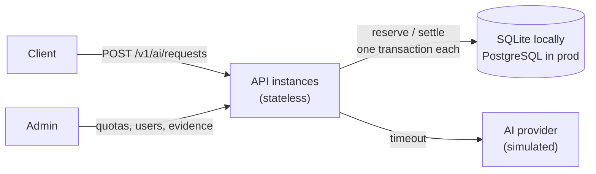
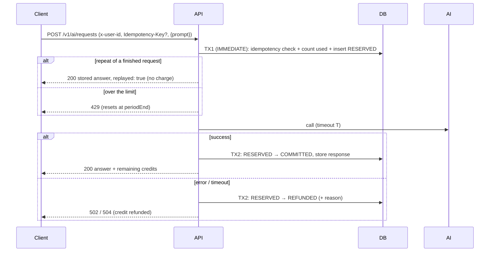

# AI Usage Metering & Quota System — Technical Design

## 0. Problem and key decisions

Every AI request costs one credit. Every request must be stored as **evidence** (billing, audits, disputes), and each user may spend at most **X credits per period** (X configurable, per user).

| # | Decision | Why |
|---|----------|-----|
| D1 | **Reserve → settle.** A credit is reserved atomically *before* the AI call, then marked `COMMITTED` (success) or `REFUNDED` (failure/timeout). | Parallel requests can't overspend; users aren't billed for our failures; every attempt still leaves evidence. |
| D2 | **One evidence row per attempt, never deleted.** Only the forward transition `RESERVED → COMMITTED/REFUNDED` is allowed. | The table *is* the evidence; rewriting history makes disputes unwinnable. |
| D3 | **The database is the only authority** for quota state. No counters in memory. | Correct across restarts and across multiple processes sharing the store. |
| D4 | **Fixed, calendar-aligned UTC periods** (`hour` / `day` / `month`). | Maps to billing periods; easy to explain to a customer ("resets on the 1st"). |
| D5 | **Fail closed.** If the limit can't be determined or the store is unavailable, the request is refused. | Unrecorded usage can't be billed or audited. A corrupt limit must block, not grant. |
| D6 | **Retries never double-charge**: `Idempotency-Key`, plus an automatic short-window dedupe when no key is sent. | Network retries and retry storms are normal; the user must pay once. |

---

## 1. Architecture and request flow





**API**

| Endpoint | Purpose |
|---|---|
| `POST /v1/ai/requests` | Header `x-user-id`, optional `Idempotency-Key`; body `{prompt}`. `200`, `400`, `409`, `429`, `502`, `504`. |
| `GET /v1/users/:userId/usage` | `{ limit, used, remaining, periodStart, periodEnd }` |
| `PUT` / `DELETE /v1/users/:userId/quota` | Set a per-user limit / revert to the default (admin). |
| `GET /v1/users`, `GET /v1/usage-events` | Overview of all users and the raw evidence rows (admin). |

The code is layered: routes (HTTP + JSON-schema validation, also used for Swagger) → services (quota logic, no HTTP) → database. The AI client and clock are injected, so tests are deterministic.

---

## 2. Data model

```sql
-- Evidence: one row per attempt.
usage_events (
  id              TEXT PRIMARY KEY,   -- UUID, returned to the client as requestId
  user_id         TEXT NOT NULL,
  status          TEXT NOT NULL CHECK (status IN ('RESERVED','COMMITTED','REFUNDED')),
  period_start    TEXT NOT NULL,      -- the period this credit belongs to (UTC)
  created_at      TEXT NOT NULL,      -- server clock
  settled_at      TEXT,
  error           TEXT,               -- AI_ERROR | AI_TIMEOUT
  idempotency_key TEXT,               -- client-supplied, optional
  request_hash    TEXT,               -- SHA-256 of the prompt
  response        TEXT                -- stored answer, for idempotent replay
);
CREATE INDEX ix_usage_user_period ON usage_events (user_id, period_start, status);
CREATE UNIQUE INDEX ux_usage_idempotency ON usage_events (user_id, idempotency_key)
  WHERE idempotency_key IS NOT NULL AND status <> 'REFUNDED';

-- Per-user limits. Users without a row get DEFAULT_CREDIT_LIMIT (env).
user_quotas (
  user_id      TEXT PRIMARY KEY,
  credit_limit INTEGER NOT NULL CHECK (credit_limit >= 0),
  updated_at   TEXT NOT NULL
);
```

**Why each field exists**
- `id`: a stable reference the customer can quote in a dispute.
- `status`, `settled_at`, `error`: prove why a credit was or wasn't billed.
- `period_start`: written at reservation time, so a request that settles after a period boundary still belongs to exactly one period.
- `request_hash` instead of the prompt: proves *which* request was made without storing user content. Storing prompts would be a separate, retention-governed decision.
- The **partial unique index** makes "one live request per key" a database guarantee, while still allowing a retry with the same key after a refunded failure. The refunded row stays as evidence.

---

## 3. Quota enforcement

**Limit resolution:** the `user_quotas` row if present, otherwise `DEFAULT_CREDIT_LIMIT`. The period comes from `QUOTA_PERIOD`. Both are read inside the reservation, so changes apply to the next request.

**Reservation** is one SQLite write transaction started with `BEGIN IMMEDIATE`:

```sql
-- 1. idempotency: an existing live row for (user, key) → replay / 409
-- 2. SELECT COUNT(*) FROM usage_events
--     WHERE user_id = :u AND period_start = :p AND status <> 'REFUNDED'
-- 3. count < limit  → INSERT ... status = 'RESERVED'
--    otherwise      → 429, nothing written
```

`IMMEDIATE` takes the database write lock *before* the count, so there is no gap between check and insert: 20 parallel requests for 1 remaining credit produce exactly one reservation, even across processes sharing the file. `RESERVED` rows count as used, otherwise in-flight requests could overspend.

**Settlement** is guarded: `UPDATE ... WHERE id = :id AND status = 'RESERVED'`, so a row can only be settled once.

**Fail closed:** a request is allowed only if `remaining > 0` evaluates true, so a corrupt limit (`NaN`, text in the column) blocks the user instead of granting unlimited credits. Config is validated at startup, so an invalid `DEFAULT_CREDIT_LIMIT` stops the server instead of running with a bad value.

---

## 4. Edge cases

| Edge case | Handling |
|-----------|----------|
| Many parallel requests, 1 credit left | Write lock before the count: exactly one wins, the rest get 429. |
| Client retries with the same `Idempotency-Key` | Stored answer returned, `replayed: true`; no AI call, no charge. |
| Retry while the first is still running | 409 `REQUEST_IN_PROGRESS`. |
| Same key, different prompt | `request_hash` mismatch → 409 `IDEMPOTENCY_KEY_REUSED`. |
| Retry after a refunded failure | Allowed as a new attempt (the index ignores `REFUNDED` rows). |
| No key, same prompt repeated within `DEDUPE_WINDOW_SECONDS` (10 s) | Treated as a retry (replay / 409). Trade-off: a deliberate identical question within 10 s returns the first answer. `0` disables it. |
| AI returns an error / exceeds timeout T | `REFUNDED` with `AI_ERROR` / `AI_TIMEOUT`, 502 / 504. A late answer is discarded. |
| Request straddles a period boundary | Belongs to the period of its reservation. |
| Limit lowered below current usage | Further requests get 429; past usage isn't clawed back. |
| Limit = 0 | Every request gets 429 (a valid way to suspend a user). |
| Negative / non-integer / huge limit | 400 (schema) and a DB `CHECK`. |
| Invalid user ID, empty/oversized prompt, unknown or wrongly typed fields | 400 **before** any reservation, so no charge. Validation is strict: no type coercion, no silent field stripping. |
| Invalid config (`DEFAULT_CREDIT_LIMIT=abc`, min delay > max delay) | Server refuses to start and lists every error. |
| Time zones, DST | All periods are UTC. |

---

## 5. Failure handling

| Failure | Behaviour | Status |
|---------|-----------|--------|
| AI provider slow | Timeout T, refund, 504. | Implemented |
| AI provider errors | Refund, 502. | Implemented |
| Database busy | Lock wait bounded by `busy_timeout` (5 s), then the request fails without charging. | Implemented |
| Database unavailable | Reservation throws → 500, no AI call (fail closed). | Implemented |
| Process crashes between reserve and settle | The row stays `RESERVED` and keeps counting against the limit (the user is blocked early, never over-charged). Production: a reaper refunds `RESERVED` rows older than T + grace. | Designed, not built |
| AI failing repeatedly | Production: a circuit breaker fails fast *before* reserving, so no charge and no load on a dead dependency. | Designed, not built |

Observability in production: counters for reservations, commits, refunds by reason, 429 and 409 rates; `requestId` as the log correlation ID.

---

## 6. Scaling

- **API instances are stateless**; correctness lives in the database transaction, so horizontal scaling needs no coordination.
- **SQLite** serializes all writers on one file. That is ideal for a local, one-command assignment and correct across processes, but caps throughput at one machine.
- **Production growth path**, in order of need:
  1. **PostgreSQL**, same schema. Replace the global write lock with a per-user lock (`SELECT ... FOR UPDATE` on the user's row, or a per-user counter row updated with `UPDATE ... WHERE used < limit`), so users don't block each other.
  2. **Counter table** `(user_id, period_start, used)` updated in the same transaction as the insert, replacing `COUNT(*)` once users have many events per period.
  3. **Partition `usage_events` by month** and archive old partitions to immutable object storage (e.g. S3 Object Lock) for tamper-evident evidence.
  4. **Read replicas** for `GET /usage` and admin views; enforcement always uses the primary.
  5. **Shard by `hash(user_id)`**: all of a user's data on one shard, so enforcement never crosses shards.
- **Abuse protection** belongs in front of the quota: authentication (user from the token, not a header), a per-user rate limit and a concurrency cap, and pagination on the admin listings.

---

## 7. Trade-offs

| Chosen | Rejected | Why |
|--------|----------|-----|
| Reserve → settle with refund | Charge after the call | Concurrent requests could overspend the quota. |
| Reserve → settle with refund | Charge every attempt | Bills users for our outages; creates disputes. |
| `COUNT(*)` over indexed events | Separate counter table | Simplest correct option at this scale: one source of truth, nothing to keep in sync. The counter table is step 2 of the growth path. |
| Database as the authority | Redis or in-memory counters | In-memory is wrong with two instances; Redis can lose recent writes on failover, and billing evidence must be durable. |
| Fixed calendar periods | Sliding window / token bucket | Maps to invoices; bursts at the start of a period are fine for a credit quota (rate limiting is a separate concern). |
| Fail closed | Fail open | Fail open means unbilled, unaudited usage. |
| Hash of the prompt | Store the prompt | Privacy and storage cost; the hash still proves which request was made. |
| Idempotency key + 10 s dedupe fallback | Key only | Protects clients that don't send keys, at the cost of merging deliberate identical questions within 10 s (configurable, can be disabled). |
| SQLite | PostgreSQL locally | The assignment requires local storage and a one-command start; the SQL and transaction semantics carry over. |

---

## 8. Implementation scope (Part B)

| Area | Implemented |
|------|-------------|
| AI endpoint with simulated delay, failure and timeout; reserve → commit/refund; every attempt recorded | Yes |
| Usage endpoint; per-user quota API; users overview and raw evidence listing; Swagger UI at `/docs` | Yes |
| Idempotency keys (replay, in-progress, key reuse, retry after refund) and keyless dedupe window | Yes |
| Strict input validation and startup config validation (fail closed) | Yes |
| Automated tests (77): concurrency, limits, refunds, periods, idempotency, validation, config | Yes |
| Reaper for crashed reservations, circuit breaker, authentication, rate limiting, PostgreSQL | No — designed above |
