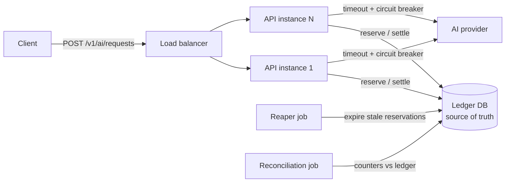
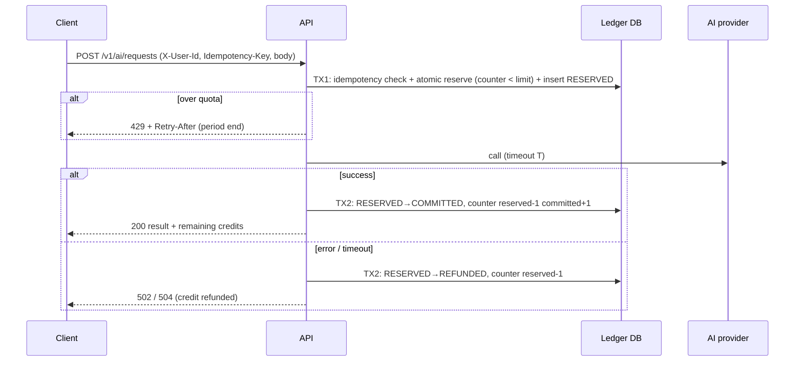

# AI Usage Metering & Quota System — Technical Design

## 0. Problem summary and key decisions

Every AI request costs one credit. Each credit must be stored as **evidence** (billing, audits, disputes), and each user may spend at most **X credits per period** (X configurable).

The decisions everything else follows from:

| # | Decision | Why |
|---|----------|-----|
| D1 | **Reserve → settle.** A credit is reserved atomically *before* the AI call, then marked `COMMITTED` (success) or `REFUNDED` (failure). | Prevents overspend under concurrency; does not bill users for our/provider failures; every attempt still leaves evidence. |
| D2 | **Append-only ledger** — one row per attempt, never deleted, only forward state transitions. | The ledger *is* the evidence. Deleting or rewriting history makes disputes unwinnable. |
| D3 | **Per-user, per-period counter row**, updated in the same transaction as the ledger. | O(1) quota check instead of `COUNT(*)` over a growing ledger. |
| D4 | **Fixed, calendar-aligned UTC windows** (e.g. monthly). | Matches billing periods and invoices; easy to explain to a customer. |
| D5 | **Fail closed** when the ledger store is unavailable. | If usage cannot be recorded it cannot be billed or audited, so it must not be served. |
| D6 | **Idempotency keys** on the request endpoint. | Network retries must never double-charge. |
| D7 | **Bias toward the customer** in ambiguous failure cases. | A lost credit is cheap; a wrongful charge costs trust and dispute handling. |

---

## 1. Architecture and request flow



**Components**

- **API instances** — stateless; hold no quota state in memory, so any instance can serve any user.
- **Ledger DB** — the single source of truth for quota and evidence (SQLite locally, PostgreSQL in production).
- **AI client** — wraps the provider with a timeout and a circuit breaker.
- **Reaper** — refunds reservations orphaned by crashes.
- **Reconciliation job** — periodically recomputes counters from the ledger and alerts on mismatch.

**Request flow**



**API surface**

- `POST /v1/ai/requests` — headers `X-User-Id` (in production derived from the auth token, never from the body) and optional `Idempotency-Key`. Responses: `200`, `400` (invalid input), `409` (idempotency conflict), `413` (body too large), `429` (quota exceeded), `502` (AI failed, refunded), `503` (store or provider unavailable, not charged), `504` (AI timeout, refunded).
- `GET /v1/users/:userId/usage` → `{ limit, used, reserved, remaining, periodStart, periodEnd }`, where `remaining = max(0, limit − used − reserved)`. In-flight reservations count against the quota; otherwise parallel requests could overspend.
- `GET /v1/users/:userId/ledger` returns the user's evidence rows for audits. `PUT /v1/users/:userId/limit` sets a per-user limit (an admin operation).

---

## 2. Data model

```sql
-- Evidence: one row per attempt. No DELETE, no UPDATE except the status transition.
usage_ledger (
  id               TEXT PRIMARY KEY,     -- UUID, returned to the client as requestId
  user_id          TEXT NOT NULL,
  idempotency_key  TEXT,                 -- client-supplied, nullable
  request_hash     TEXT NOT NULL,        -- SHA-256 of the canonical request body
  status           TEXT NOT NULL,        -- RESERVED | COMMITTED | REFUNDED
  credits          INTEGER NOT NULL DEFAULT 1,
  period_start     TEXT NOT NULL,        -- the period this credit belongs to (UTC)
  created_at       TEXT NOT NULL,        -- reservation time (server clock)
  settled_at       TEXT,
  latency_ms       INTEGER,
  error_code       TEXT,                 -- AI_ERROR | AI_TIMEOUT | RESERVATION_EXPIRED ...
  response_json    TEXT                  -- stored for idempotent replay
);
CREATE UNIQUE INDEX ux_ledger_idem ON usage_ledger(user_id, idempotency_key)
  WHERE idempotency_key IS NOT NULL AND status <> 'REFUNDED';
CREATE INDEX ix_ledger_user_period ON usage_ledger(user_id, period_start);
CREATE INDEX ix_ledger_reserved    ON usage_ledger(status, created_at);

-- Fast quota state, always changed in the same transaction as the ledger.
user_period_usage (
  user_id TEXT, period_start TEXT,
  reserved INTEGER NOT NULL DEFAULT 0,
  committed INTEGER NOT NULL DEFAULT 0,
  PRIMARY KEY (user_id, period_start)
);

-- Per-user overrides. The global default limit and the period (hour|day|month) come from configuration.
user_quota_limit  (user_id TEXT PRIMARY KEY, credit_limit INTEGER NOT NULL CHECK (credit_limit >= 0), updated_at TEXT);
```

Immutability is enforced in the database itself, not only by application code: triggers reject any `DELETE` on the ledger and any `UPDATE` other than a single `RESERVED → COMMITTED/REFUNDED` transition. SQLite runs with `synchronous = FULL`, so a committed evidence row survives power loss.

**Why each field exists**

- `id`: a stable reference the customer can quote in a dispute.
- `status` + `settled_at` + `error_code`: prove why a credit was or was not billed.
- `period_start`: written at reservation time, so a credit belongs to exactly one period even if it settles after the boundary.
- `request_hash` instead of the prompt: proves *which* request was made without storing user content (privacy, storage cost). Storing prompts would be a separate, retention-governed decision.
- `latency_ms`: supports operational analysis and "it never answered" disputes.
- The **partial unique index** enforces idempotency while still allowing a *new* attempt with the same key after a refunded failure. The refunded row stays as evidence.
- `credits` lets the system move to variable pricing (e.g. per token) later without a schema change.

---

## 3. Quota enforcement

The reservation runs as **one write transaction** (`BEGIN IMMEDIATE` in SQLite, a normal transaction in PostgreSQL):

```sql
INSERT INTO user_period_usage(user_id, period_start) VALUES (:u, :p) ON CONFLICT DO NOTHING;
UPDATE user_period_usage
   SET reserved = reserved + 1
 WHERE user_id = :u AND period_start = :p
   AND reserved + committed + 1 <= :limit;     -- the check and the increment are one statement
-- affected rows = 0  →  429, nothing written
-- affected rows = 1  →  INSERT usage_ledger (status = 'RESERVED') in the same transaction
```

The conditional `UPDATE` is the whole concurrency story. The row is locked during the update, so there is no window between "check" and "increment", whether the requests hit one instance or many.

Settlement is guarded the same way: `UPDATE usage_ledger SET status = 'COMMITTED' … WHERE id = :id AND status = 'RESERVED'`. The counter changes only if that update affected a row. This makes settlement idempotent and race-safe against the reaper: whoever moves the row out of `RESERVED` first wins, and the other is a no-op.

**Period computation** uses the server/DB clock in UTC, never the client's clock. The limit is read inside the reservation transaction, so configuration changes take effect on the next request.

---

## 4. Edge cases

| Edge case | Handling |
|-----------|----------|
| Many parallel requests with 1 credit left | Atomic conditional `UPDATE`: exactly one wins, the rest get 429. |
| Client retries after a network error (same key) | Returns the stored response. No second charge. |
| Same key, different body | `request_hash` mismatch → 409. |
| Same key while the first request is still in flight | 409 "in progress" (unique index on a `RESERVED` row). |
| Retry with the same key after a refunded failure | Allowed as a new attempt. The partial index ignores `REFUNDED` rows. |
| No idempotency key | Request is processed, but there is no retry protection (documented). |
| AI returns an error | `REFUNDED`, `error_code = AI_ERROR`, 502. |
| AI is slow, beyond timeout T | `REFUNDED`, `AI_TIMEOUT`, 504. A late answer is discarded. |
| Client disconnects mid-call | The call continues and is committed. The cost was incurred and the result is replayable via the idempotency key. |
| Instance crashes after reserve, before settle | The reaper refunds `RESERVED` rows older than `T + grace` with `RESERVATION_EXPIRED`. |
| AI succeeded but the settlement write fails | Retry settlement with backoff. If it still fails, return the result, log an alert, and let the reaper refund (D7: under-bill rather than over-bill). |
| Request straddles a period boundary | Belongs to the period of its reservation (`period_start` is stored on the row). |
| Limit lowered below current usage | Further requests get 429. Past usage is not clawed back. |
| Limit raised mid-period | Effective immediately. |
| Limit = 0 | Every request gets 429 (a valid way to suspend a user). |
| Negative or non-integer limit | Rejected by validation and a DB `CHECK`. |
| Missing or malformed `X-User-Id` | 400. An unseen but valid user ID gets the default limit; production would rely on authentication. |
| Invalid body (missing or empty prompt, wrong type, unknown fields) | 400 before any reservation, so no charge. Bodies are validated strictly: no silent type coercion or field stripping. |
| Oversized body | 413 before any reservation. |
| Clock skew between instances | Period comes from one clock (the DB in production), not per-instance clocks. |
| Time zones, DST | All periods are UTC. |
| User deleted | Ledger rows are retained for the legal or billing retention period. Personal data handling is a separate policy. |
| Counter drifts from the ledger (bug or manual edit) | Reconciliation job recomputes from the ledger, which is authoritative, and alerts. |

---

## 5. Failure handling

| Failure | Behaviour | Reasoning |
|---------|-----------|-----------|
| Ledger DB **down** | 503, no AI call. | Fail closed (D5): unrecorded usage cannot be billed or audited. |
| Ledger DB **slow** | Bounded lock wait (`busy_timeout` / `lock_timeout`), then 503. | Avoids piling up requests and exhausting connections. |
| AI provider **slow** | Timeout T, refund, 504. | The user is not charged for our provider's latency. |
| AI provider **failing repeatedly** | Circuit breaker opens: fail fast with 503 *before* reserving. | No charge, no load on a dead dependency, quick recovery once it half-opens. |
| API instance **crash** | Stateless, so the load balancer routes elsewhere. Orphaned reservations are refunded by the reaper. | Nothing is lost except in-flight work, which is refunded. |
| Reaper **down** | Orphaned reservations temporarily reduce the user's remaining quota. | Degrades safely: users are blocked early, never charged wrongly. Alert on reaper lag. |

Observability: metrics for reservations, commits, refunds by reason, 429 rate, reaper actions and reconciliation mismatches. The requestId is used as the correlation ID in logs.

---

## 6. Scaling

- **Horizontal API scaling** is free: instances are stateless and correctness lives in the DB transaction.
- **Contention is per user.** Each request locks only its own user's counter row, so users don't block each other. A single very hot user is serialized on their row, which is the correct behaviour for a strict quota.
- **Cost per request:** two short single-row transactions plus one indexed insert. PostgreSQL handles thousands of these per second per node.
- **Growth path**, in order of need:
  1. PostgreSQL with a connection pooler (PgBouncer).
  2. Monthly partitioning of `usage_ledger`; old partitions archived to object storage (e.g. S3 with Object Lock for tamper-evident evidence).
  3. `GET /usage` served from a read replica. It may lag slightly, which is acceptable for display; enforcement always uses the primary.
  4. Shard by `hash(user_id)`. All of a user's data lives on one shard, so enforcement never needs cross-shard coordination.
  5. If DB write latency becomes the bottleneck: Redis (Lua script) for the hot-path check, with a durable ledger write behind it and reconciliation. This is a deliberate step away from strict consistency (see trade-offs).

---

## 7. Trade-offs

| Chosen | Rejected | Why |
|--------|----------|-----|
| Reserve → settle | Charge after the call | Charging afterwards lets concurrent requests overspend the quota. |
| Reserve → settle with refund | Charge every attempt | Bills users for outages; generates disputes. |
| Counter row + ledger in one transaction | `COUNT(*)` over the ledger | O(n) per request; gets slower as the business grows. |
| DB as the authority | Redis-only counters | Redis can lose recent writes on failover, and billing evidence must be durable. Kept as a future optimisation behind a durable ledger. |
| DB as the authority | Per-instance in-memory counters | Wrong as soon as there are two instances. |
| Fixed calendar windows | Sliding window / token bucket | Smoother traffic, but doesn't map to billing periods. Allows bursts at the period start, which is acceptable for a credit quota (rate limiting is a separate concern). |
| Fail closed | Fail open | Fail open is better availability but means unbilled, unaudited usage. |
| Synchronous ledger write | Async via queue (outbox/Kafka) | Lower latency, but the quota check needs the current count; async writes allow overspend. |
| Store request hash | Store full prompt | Privacy and storage cost; the hash still proves which request was made. |
| SQLite locally | PostgreSQL locally | The assignment requires local storage and a one-command start. The SQL and transaction semantics carry over directly. |

---

## 8. Implementation scope (Part B)

| Area | Implemented | Notes |
|------|-------------|-------|
| `POST /v1/ai/requests` with simulated AI (random delay and failure) | Yes | AI client and clock are injectable for deterministic tests. |
| Atomic reserve → commit/refund, ledger as evidence | Yes | SQLite with `better-sqlite3`; immutability enforced by DB triggers. |
| `GET /v1/users/:userId/usage`, `GET …/ledger`, `PUT …/limit` | Yes | |
| Configurable default limit, per-user override, period | Yes | Default and period via environment variables; overrides via `PUT …/limit`. |
| Idempotency keys (replay, conflict, in-flight, retry after refund) | Yes | |
| AI timeout and refund; settlement retries | Yes | |
| Fail closed when the store is down (503) | Yes | |
| Reaper for stale reservations | Yes | Runs at startup and on an interval in-process. |
| Multi-process contention test | Yes | 4 OS processes share one DB file; exactly `limit` reservations succeed. |
| Circuit breaker | No | Described above. Out of scope for the time budget. |
| Reconciliation job | No | Described above. The invariant it would check is asserted in tests. |
| Authentication | No | User identified by the `X-User-Id` header. |
| PostgreSQL, Redis, sharding, archiving | No | Production design only. |
