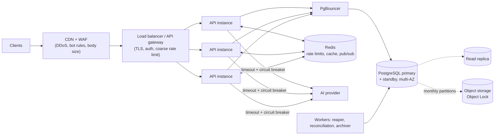

# Going to Production

What the local implementation would need before serving real traffic, in priority order. The core logic (reserve → settle, idempotency, fail closed) stays the same; what changes is everything around it.

## Target architecture

Only the CDN/WAF and the load balancer are public. API instances, the database and Redis live in private subnets; security groups allow only LB → API → DB/Redis.

## 1. Security (before anything else)

| What | Why |
|---|---|
| **Authentication**: user ID from a verified JWT / API key, never from the `x-user-id` header | Today anyone can spend anyone's credits by changing a header. |
| **Admin endpoints** (`/quota`, `/users`, `/usage-events`) behind an admin role, or only on the internal network | Today anyone can give themselves unlimited credits. |
| **TLS** terminated at the load balancer | |
| **Firewall in two layers**: a WAF at the edge (DDoS, known bad IPs, bot rules, max body size, geo rules if needed) and network security groups (DB and Redis unreachable from the internet) | The WAF stops garbage before it costs anything; network rules limit the damage of a compromise. |
| **Secrets** in a secrets manager; DB user with least privilege (no `DELETE` on `usage_events`) | Evidence can't be erased even by a bug or a leaked app credential. |
| **Audit log** for admin changes (who changed whose limit, when) | Limits are billing data too. |

## 2. Load balancer and multiple instances

- The API is already stateless (all quota state is in the database), so N instances behind a load balancer need **no sticky sessions**.
- Add **`/health`** (process alive) and **`/ready`** (DB reachable) endpoints for LB health checks and zero-downtime deploys.
- **Graceful shutdown**: on SIGTERM stop accepting requests, let in-flight AI calls finish and settle, then exit. Otherwise every deploy leaves `RESERVED` rows behind.
- Run instances in **at least two availability zones**; autoscale on CPU / in-flight requests.

## 3. Database: SQLite → PostgreSQL

- **Managed PostgreSQL** (RDS / Aurora / Cloud SQL), primary + standby, automated backups with point-in-time recovery.
- **Per-user locking instead of a global lock**: a counter row `(user_id, period_start, used)` updated with `UPDATE ... SET used = used + 1 WHERE used < :limit` in the same transaction as the evidence insert. Users no longer block each other, and there is no `COUNT(*)`.
- **PgBouncer** in front: many API instances, few DB connections.
- **Migrations** with a proper tool (e.g. node-pg-migrate) run in CI, instead of `CREATE TABLE IF NOT EXISTS` at startup.
- **Partition `usage_events` by month**; archive old partitions to object storage with Object Lock (tamper-evident, cheap).
- Admin listings and `GET /usage` from a **read replica**; enforcement always on the primary.

## 4. Cache — where it helps and where it must not be used

| Use cache? | For what | How |
|---|---|---|
| **Never** | The quota decision itself | It must be strongly consistent; a stale count lets users overspend. The DB transaction stays the authority. |
| Yes | **Rate limiting** (requests per second per user / per IP) | Redis token bucket. Cheap rejection *before* touching the DB. |
| Yes | **In-flight coalescing / response cache** for identical prompts | Redis `SET NX` lock on `hash(user, prompt)` + short TTL replaces the SQLite dedupe window across instances. A cross-user answer cache is only valid for deterministic, non-personal prompts — a product decision. |
| Yes, short TTL | **User limits** (`user_quotas`) | Read on every request, change rarely. Invalidate on `PUT/DELETE /quota` via pub/sub, or TTL of a few seconds. |
| Optional | `GET /usage` for dashboards | A few seconds stale is fine for display. |
| Keep in the DB | Idempotency records | They are part of the evidence; the unique index is the guarantee. Redis can sit in front as a fast path only. |

## 5. Real time

- **Stream AI answers** to the client with **SSE** (or WebSocket): the user sees tokens as they arrive instead of waiting seconds. The credit is still reserved before the stream starts and settled when it ends or breaks.
- **Long or heavy requests asynchronously**: `202 Accepted` + `requestId`, work done by a worker from a queue (SQS / RabbitMQ / Kafka), result pushed via SSE or fetched by ID. Decouples API latency from the AI provider and smooths spikes.
- **Live usage updates**: after each commit/refund publish `usage.changed` to Redis pub/sub; whichever instance holds the user's SSE connection pushes the new `remaining`. Needed because with several instances the event and the connection are usually on different machines.
- **Notifications** at 80% / 100% of the quota (email, webhook, in-app), from the same event stream.
- **Transactional outbox** for billing/analytics: write the event row and an outbox row in the same transaction, a worker publishes to Kafka. Billing and analytics never block or lose the request path.

## 6. Reliability

- **Reaper**: refunds `RESERVED` rows older than AI timeout + grace (crashed instance, killed deploy).
- **Circuit breaker** around the AI provider: after repeated failures fail fast with 503 *before* reserving — no charge, no load on a dead dependency.
- **Retries to the provider** with backoff + jitter, only for safe errors and within the overall timeout.
- **Concurrency cap per user** (e.g. 5 in-flight) to stop one user from tying up AI capacity.
- **Reconciliation job**: compares counters with the evidence table and alerts on mismatch.

## 7. Observability

- **Logs**: structured JSON (already via Fastify/pino), `requestId` as correlation ID, no prompts in logs.
- **Metrics** (Prometheus / Datadog): reservations, commits, refunds by reason, 409 / 429 rates, AI latency p50/p95/p99, DB lock wait, reaper actions.
- **Tracing** (OpenTelemetry): API → DB → AI in one trace.
- **Alerts**: refund rate spike (provider down), 5xx rate, reaper lag, reconciliation mismatch.

## 8. Delivery

- **Docker** image, deployed to Kubernetes / ECS; config via environment, secrets from the secrets manager.
- **CI/CD**: typecheck, tests, migration dry-run, image scan; blue/green or canary deploys with automatic rollback on error-rate increase.
- **Load test** (k6) before launch: target RPS, hot-user scenario, retry-storm scenario.

## Recommended order

1. Authentication + admin protection (security hole today).
2. PostgreSQL with per-user counter rows, backups.
3. Load balancer, `/health` + `/ready`, graceful shutdown, reaper.
4. WAF + Redis rate limiting + per-user concurrency cap.
5. Observability and alerts.
6. Circuit breaker, Redis coalescing/cache.
7. Real-time: SSE streaming, live usage, async queue — when the product needs it.
