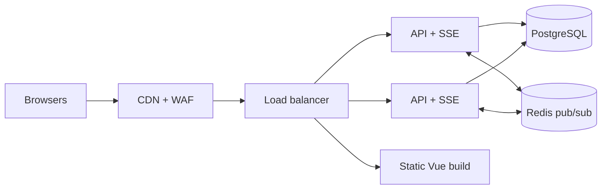

# Going to Production — Task Board

What the local demo would need before real multi-user traffic. The shared-state model (one store, computed derived data, versioned SSE events) stays; what changes is everything around it.

## Edge cases (already handled)

| Case | Handling |
|---|---|
| Duplicate / out-of-order SSE events | Ignored via `task.version` |
| Late update after delete | `deletedIds` blocks resurrection until the next snapshot |
| Edit while someone else edits a different field | Field-level `PATCH`; both survive |
| Edit while someone else edits the same field | Last write wins; editor shows a conflict notice if the draft is dirty |
| Selected task deleted remotely | Editor shows "This task was deleted" |
| Save/delete fails | Optimistic change rolled back (unless a newer server version arrived) |
| Reconnect after offline | Fresh snapshot replaces client state |
| Blank title / invalid enums | Rejected in UI and by server schema |

## Bugs / gaps found in the current code

| Issue | Severity | Where | Fix |
|---|---|---|---|
| ~~**SSE `write` to a dead socket can throw**~~ | — | — | **Fixed:** try/catch in `publish`; dead subscriber dropped |
| ~~**`JSON.parse` on SSE messages has no try/catch**~~ | — | — | **Fixed:** bad frames ignored in `connection.ts` |
| **`deletedIds` grows forever** until a reconnect clears it | Low | `src/stores/board.ts` | Cap the set, or drop IDs older than N minutes |
| ~~**Double-click / rapid inline edits**~~ | — | — | **Fixed:** per-task `pending` lock + "Saving…" in the UI |
| **No optimistic locking on `PATCH`** — client doesn't send the version it based the edit on, so silent overwrite of the same field is possible | Medium | API | Require `If-Match: version` (or body `baseVersion`); return 409 on mismatch |
| **Invalid `VITE_MAX_ACTIVITY`** becomes `NaN` and breaks the activity slice | Low | store | Validate / fall back to 50 |
| **Two open tabs both act as `"user"`** — activity can't tell who did what | Expected for demo | — | Real auth + display name |
| **List is editable while editor has a dirty draft of the same task** — inline change can race the Save | Low | UI | Disable list controls for the selected dirty task, or always go through the editor |

## Bottlenecks

| Bottleneck | Why it hurts | Production approach |
|---|---|---|
| **In-memory board** | Restart loses all data; can't run 2 API instances (each has its own Map) | PostgreSQL (or Redis + durable log) as the source of truth |
| **SSE fan-out in-process** | Every change writes to every open connection on that one Node process | Redis pub/sub (or NATS) between API instances; each instance fans out only to its own sockets |
| **Full snapshot on every reconnect** | Large boards → big payloads and UI freezes | Snapshot + `since` cursor / event id; client requests only missed events |
| **`taskList` sorts on every change** | O(n log n) per keystroke/update | Keep an ordered index, or virtualize the table |
| **All panels re-render together** | Fine for dozens of tasks; noisy at thousands | Pinia store-to-refs / split stores; virtual lists |
| **Simulator on the API process** | Demo only; would fight real traffic | Separate worker / cron / user actions only |
| **No rate limiting** | One client can spam `PATCH` / open many SSE connections | Per-user and per-IP limits; max SSE connections per user |

## What to add for production

1. **Auth** — JWT / session; every REST call and SSE stream tied to a user/org. No anonymous writes.
2. **Persistence** — tasks and activity in PostgreSQL; migrations; backups.
3. **Multi-instance SSE** — publish events to Redis; each API process forwards to its local subscribers.
4. **Optimistic concurrency** — `PATCH` with expected version → 409 Conflict if stale (better than silent last-write-wins).
5. **Hardening** — fix the SSE write try/catch; validate SSE payloads; rate limits; body size limits; CORS only if the UI is on another origin.
6. **Observability** — metrics for connected SSE clients, event lag, 409 rate, API latency; structured logs with `requestId` / `taskId`.
7. **Delivery** — build the Vue app (`vite build`), serve static files (or CDN); API as a container; `/health` + `/ready`; graceful shutdown (already partly there).
8. **Product extras (optional)** — real users instead of a fixed TEAM list; permissions; offline queue; undo; search/filter; pagination.

## Recommended order

1. ~~Fix SSE publish try/catch and in-flight edit guard~~ (done).
2. Persist to PostgreSQL + auth.
3. Version check on `PATCH` (409).
4. Redis pub/sub for multi-instance SSE.
5. Rate limits, metrics, CDN for the static UI.
